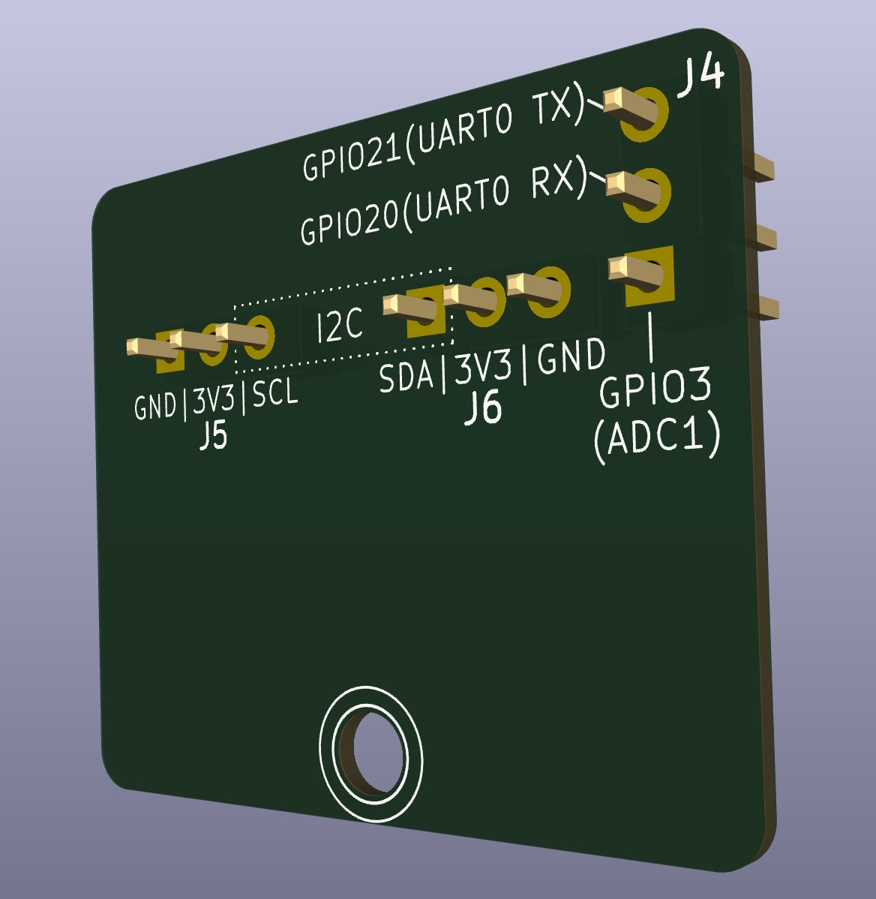

# [KiCad](https://www.kicad.org/) Daughterboard Starter Project 
### Instructions
1. Extract the ZIP file to a convenient location
2. In KiCad, select "Open Project" and select "ESP32-MicroC3-Daughterboard.kicad_pro"
### Notes
1. This board stackup is based on [Oshpark's 2-layer HHDC](https://docs.oshpark.com/services/two-layer-hhdc/)
2. The connectors, board outline, and mounting hole are all locked to prevent accidental changes that would invalidate your design

